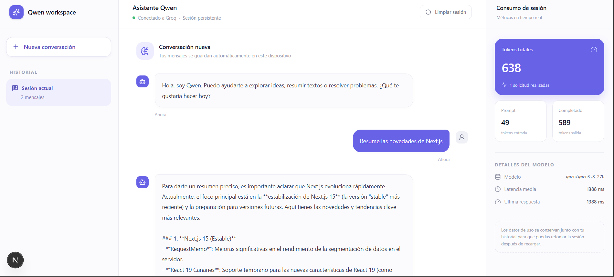

# Prototipo de chat con Groq

Prototipo funcional de una interfaz de chat en React/Next.js que se comunica con un modelo de lenguaje real (Qwen 3.8B) a través de la API de [Groq](https://groq.com/). Mide y acumula el consumo de tokens en tiempo real, persiste la sesión en el navegador y muestra el estado de cada petición.



---

## Índice

- [Estructura del proyecto](#estructura-del-proyecto)
- [Tecnologías](#tecnologías)
- [Requisitos](#requisitos)
- [Puesta en marcha](#puesta-en-marcha)
- [Arquitectura y flujo](#arquitectura-y-flujo)
- [Funcionalidades](#funcionalidades)
- [Métricas de uso](#métricas-de-uso)
- [Persistencia](#persistencia)
- [Modo de uso](#modo-de-uso)

---

## Estructura del proyecto

```text
app/
├── api/chat/route.ts        # API route — proxy hacia Groq (fetch nativo, sin SDK)
├── globals.css              # Tema CSS (shadcn/ui + Tailwind CSS 4)
├── layout.tsx               # Layout raíz con metadatos e iconos
└── page.tsx                 # Página principal — chat, métricas y persistencia
components/
└── ui/button.tsx            # Botón reutilizable con variantes (shadcn)
lib/
└── utils.ts                 # Utilidad cn() para combinar clases CSS
public/                      # Iconos, logo y placeholders estáticos
.next/                       # Compilación de Next.js (Turbopack)
.env.example                 # Plantilla de variables de entorno
.env                         # Variables de entorno local (no versionado)
.gitignore
rules.md                     # Reglas de trabajo acordadas
context.md                   # Contexto y requisitos del proyecto
Spec.md                      # Especificación con criterios de aceptación
README.md                    # Este documento
components.json              # Configuración de shadcn/ui
next.config.mjs              # Configuración de Next.js
package.json                 # Dependencias y scripts
postcss.config.mjs           # Configuración de PostCSS
tsconfig.json                # Configuración de TypeScript
```

---

## Tecnologías

| Capa | Tecnología |
|------|-----------|
| Framework web | **Next.js 16** (App Router, Turbopack) |
| Lenguaje | **TypeScript 5.7**, **React 19** |
| UI / CSS | **Tailwind CSS 4**, **shadcn/ui**, **Lucide** (iconos) |
| Backend API | **Next.js API Route** — `fetch` nativo (sin SDK) |
| Proveedor IA | **Groq** — modelo `qwen/qwen3.8-27b` |
| Persistencia | **localStorage** del navegador |
| Paquetería | **pnpm** |

---

## Requisitos

- **Node.js 20+** y **pnpm** instalados
- Una cuenta en [Groq Console](https://console.groq.com/) con una **API Key** activa
- El modelo `qwen/qwen3.8-27b` debe estar disponible en tu plan (es gratuito)

---

## Puesta en marcha

### 1. Clonar e instalar dependencias

```bash
pnpm install
```

### 2. Configurar la API Key

Copia el archivo de ejemplo y edítalo con tu clave de Groq:

```bash
cp .env.example .env
```

El contenido de `.env` debe ser:

```dotenv
GROQ_API_KEY=gsk_tu_clave_real_de_groq
```

> **⚠️ Seguridad:** El `.env` no está versionado (está en `.gitignore`). `GROQ_API_KEY` se usa exclusivamente del lado del servidor. No uses el prefijo `NEXT_PUBLIC_`.

### 3. Verificar la conexión

```bash
export $(grep -v '^#' .env) && curl -s \
  "https://api.groq.com/openai/v1/chat/completions" \
  -H "Content-Type: application/json" \
  -H "Authorization: Bearer $GROQ_API_KEY" \
  -d '{"model":"qwen/qwen3.8-27b","messages":[{"role":"user","content":"responde solo con: ok"}],"max_tokens":5}'
```

Debe responder con un `200 OK` y el contenido `"ok"`.

### 4. Iniciar el servidor de desarrollo

```bash
pnpm dev
```

Abre [http://localhost:3000](http://localhost:3000) en el navegador.

### 5. Compilar para producción

```bash
pnpm build
pnpm start
```

---

## Arquitectura y flujo

```text
 Navegador (cliente)                Servidor Next.js                Groq API
 ┌──────────────────────┐          ┌────────────────────┐         ┌──────────┐
 │                      │          │                    │         │          │
 │  page.tsx            │  fetch   │  api/chat/route.ts │  fetch  │  Groq    │
 │  (React 19)          │ ────────→│  (Next.js Route)   │ ───────→│  /v1     │
 │                      │          │                    │         │          │
 │  • useState          │ ←────────│  ←─────────────────│ ←───────│          │
 │  • localStorage      │  JSON    │  • valida mensajes  │         │          │
 │  • fetch nativo      │          │  • llama a Groq     │         │          │
 │                      │          │  • mide latencia    │         │          │
 └──────────────────────┘          └────────────────────┘         └──────────┘
```

### Flujo paso a paso

1. **El usuario escribe** en el `<textarea>` y pulsa Enter (o el botón de envío).
2. **El frontend** añade el mensaje del usuario al estado `messages`, activa el estado `isLoading` y envía el historial completo al backend vía `POST /api/chat`.
3. **El backend** recibe los mensajes, los envía a Groq mediante `fetch` nativo (sin SDK), mide la latencia y devuelve la respuesta del modelo junto con los metadatos de uso.
4. **El frontend** recibe la respuesta, la añade al estado, actualiza los acumulados de `usage` y desactiva `isLoading`.
5. **La UI** se renderiza con los nuevos mensajes y métricas. El scroll baja automáticamente.
6. **La persistencia** se dispara mediante `useEffect` cada vez que `messages` o `usage` cambian, guardando en `localStorage`.
7. **Al recargar la página**, un `useEffect` inicial restaura el historial y las métricas desde `localStorage`.

---

## Funcionalidades

| Funcionalidad | Cómo se implementa |
|---------------|-------------------|
| **Chat conversacional** | `useState<Message[]>` que almacena todos los turnos. Se envía el historial completo a Groq en cada petición. |
| **Indicador de carga** | Estado `isLoading` controlado con `useState`. Muestra una animación de tres puntos rebotando. El botón de envío se deshabilita mientras carga. |
| **Manejo de errores** | Si la API devuelve un error (HTTP no 2xx), se muestra el mensaje de error como una respuesta del asistente. Errores de red también se capturan. |
| **Métricas por respuesta** | Los valores `usage` devueltos por Groq (`prompt_tokens`, `completion_tokens`, `total_tokens`) se muestran en el panel lateral derecho. |
| **Acumulados de sesión** | Cada nueva respuesta suma sus tokens a los acumulados anteriores, no los sobrescribe. |
| **Métrica adicional** | Se muestra la **latencia media** (ms), el modelo utilizado y la latencia de la última respuesta. |
| **Persistencia** | `useEffect` guarda en `localStorage` tras cada cambio. Al recargar, se restaura el historial y las métricas. |
| **Limpiar sesión** | Botón en el header que borra `localStorage` y resetea el estado a valores iniciales. |
| **Copiar mensaje** | Botón de copia al pasar el ratón sobre cada respuesta del asistente. |

---

## Métricas de uso

El panel lateral derecho (visible en pantallas ≥1280px) muestra:

| Métrica | Descripción | Cálculo |
|---------|------------|---------|
| **Tokens totales** | Suma de prompt + completado de toda la sesión | `usage.promptTokens + usage.completionTokens` |
| **Prompt** | Toks de entrada acumulados | Suma de `usage.prompt_tokens` de cada respuesta |
| **Completado** | Toks de salida acumulados | Suma de `usage.completion_tokens` de cada respuesta |
| **Solicitudes** | Número de peticiones realizadas | Contador incremental |
| **Modelo** | Identificador del modelo usado | `qwen/qwen3.8-27b` |
| **Latencia media** | Tiempo medio de respuesta | `latenciaTotal / solicitudes` |
| **Última respuesta** | Tiempo de la última respuesta | Latencia de la petición más reciente |

---

## Persistencia

- **Datos guardados:** `messages` (historial completo) y `usage` (acumulados de sesión).
- **Mecanismo:** `localStorage` del navegador, en las claves `qwen-chat-messages` y `qwen-chat-usage`.
- **Cuándo se guarda:** En cada mutación de `messages` o `usage`, mediante `useEffect`.
- **Cuándo se restaura:** Al montar el componente (`useEffect` con array vacío), se lee `localStorage` y se actualiza el estado.
- **Borrado:** El botón "Limpiar sesión" elimina las claves de `localStorage` y resetea el estado.
- **Limitación:** La persistencia es por navegador/dispositivo. No hay sincronización entre dispositivos.

---

## Modo de uso

1. Abre la aplicación en el navegador.
2. Escribe un mensaje en el campo de texto y pulsa **Enter** (o haz clic en el botón de envío).
3. Espera la respuesta del asistente. Verás los tres puntos animados mientras carga.
4. Las métricas de consumo aparecen en el panel derecho.
5. Puedes **copiar** cualquier respuesta pasando el ratón sobre ella y haciendo clic en el icono de copia.
6. Para **empezar de cero**, haz clic en "Limpiar sesión" en la cabecera.
7. Si cierras la pestaña y vuelves a abrirla, la conversación se restaura automáticamente.

---

## Documentación relacionada

- [`context.md`](./context.md) — Contexto y requisitos originales del proyecto.
- [`Spec.md`](./Spec.md) — Especificación técnica con criterios de aceptación.
- [`rules.md`](./rules.md) — Reglas de trabajo acordadas.